# 자전거 의인화 테마 — 프롤로그·엔딩 컷신

작성: 2026-10-30 · 추적 이슈: [#44](https://github.com/kthss01/mini-danmaku-ai-claude/issues/44) · fork 브랜치: `kthss01/taisei` `feat/theme-prologue`(fork master `e1b6f29a` 기준, Draft PR [kthss01/taisei#8](https://github.com/kthss01/taisei/pull/8))

첫 실행 때 나오는 프롤로그(Introduction)와 엔딩 6종·엑스트라 인트로 3종을 자전거 의인화 테마에 맞게 고친 기록이다. 줄거리는 #44에서 승인받았다([프롤로그 초안](https://github.com/kthss01/mini-danmaku-ai-claude/issues/44#issuecomment-6507937127), [엔딩·엑스트라 초안](https://github.com/kthss01/mini-danmaku-ai-claude/issues/44#issuecomment-6508090895), [승인 기록](https://github.com/kthss01/mini-danmaku-ai-claude/issues/44#issuecomment-6508118519)). 게임 규칙(탄·판정·행동)과 스테이지 대화는 바꾸지 않는다.

## 1. 컷신 구조

| 항목 | 내용 |
| --- | --- |
| 정의 파일 | fork `src/cutscenes/<이름>.inc.h`. `scenes.c`가 `g_cutscenes[]`에 `#include`로 묶는다 |
| 장면 | `{ "<이미지 이름>", { 대사…, {} } }` 배열. 장면이 바뀔 때만 이미지가 페이드된다 |
| 화자 | `scene_impl.h`의 `T_NARRATOR`, `T_REIMU`, `T_MARISA`, `T_YOUMU`, `T_ELLY` 등. 나레이션이 `\n`으로 끝나면 다음 줄이 같은 문단에 이어진다 |
| 넘김 | Z/Enter로 한 줄씩, Esc로 전체 건너뛰기(첫 시청 프롤로그도 가능, fork #2 `feat/intro-skip`) |
| 재생 시점 | 프롤로그: 첫 실행(진행 기록에 해금 표시가 없을 때). 엔딩: 스테이지 6 클리어(컨티뉴 사용 시 배드). 엑스트라 인트로: 게임 흐름에서 아직 호출되지 않음(엑스트라 스테이지 미완성) |
| 번역 | 문자열은 `N_()`/`T_*()`로 gettext 대상이다. 한국어는 fork `po/ko.po` |

## 2. 줄거리

### 2.1 프롤로그 (12장면 → 8장면)

화자는 나레이션과 플레이어 3명(레이무·마리사·요우무)만 남겼다. 자전거 의인화 캐릭터 5종은 이름·정체·역할을 밝히지 않고 **방울 소리("따릉따릉"), 가느다란 바퀴 자국 두 줄, 다섯 가지 색의 잔상**(빨강·검정 / 흰색·연보라 / 남색·금색 / 민트·크림 / 버건디·아이보리)으로만 암시한다. 스테이지 2~6 대화가 그대로이므로 "여름 내내 감돌던 꺼림칙한 기운"과 "요괴의 산으로 향한다"는 줄기는 남겼다.

| # | 이미지 | 내용 |
| --- | --- | --- |
| 1 | `locations/hakurei` | 여름의 끝, 하쿠레이 신사에서 차를 마시는 세 사람. 꺼림칙한 기운(기존 문장 4줄 유지) |
| 2 | `opening/01` | 방울 소리와 함께 무언가가 도리이 앞을 지나감. 마리사·레이무 반응 |
| 3 | `opening/01` | 흙바닥의 가느다란 두 줄 자국. 수레보다 좁다 |
| 4 | `opening/02` | 며칠 사이 안개의 호수·마법의 숲·산길에 같은 자국. 목격담은 다섯 색의 잔상뿐 |
| 5 | `opening/02` | "요괴가 언제부터 바퀴를?" / "요괴가 아닐지도" / "빠르면 겨뤄 보자" |
| 6 | `opening/03` | 모든 자국이 요괴의 산으로. 산에 가까울수록 기운이 짙어짐 |
| 7 | `opening/04` | 신사 길 아래에서 다시 울리는 방울. 세 사람 출발 결심 |
| 8 | `locations/hakurei` | 두 줄 자국을 따라, 요괴의 산 꼭대기까지 이어질 경주로 |

기존 프롤로그가 빌려 쓰던 엔딩 이미지 `reimu_bad/01`은 더 쓰지 않는다.

### 2.2 엔딩·엑스트라 인트로 (A안: 뼈대 유지 + 장면 1개 추가)

바벨탑·엘리·쿠루미(스테이지 6·4 보스) 줄거리와 조연 장면은 그대로 두고, 컷신마다 프롤로그의 라이더 이야기를 마무리하는 장면을 하나씩 넣었다. 라이더는 "탑의 부름에 끌린 존재"라는 암시까지만 둔다. 새 장면은 기존 이미지를 다시 쓰므로 새 그림이 필요 없다.

| 컷신 | 추가 위치 | 내용 |
| --- | --- | --- |
| 레이무 배드 | 술병 장면 뒤 | 탑이 멈춘 뒤 방울 소리가 끊김. "새전 한 푼 안 남기고 사라졌네" |
| 레이무 굿 | 마지막 나레이션 앞 | 이따금 들리는 방울과 새 자국. 레이무가 '감시'를 더 하기로 함 |
| 레이무 엑스트라 | 마지막 나레이션 앞 | 탑이 다시 켜지자 방울 다섯이 한꺼번에 울리며 산으로 |
| 마리사 배드 | 플랑드르 장면 뒤 | 쫓던 라이더가 자국도 없이 사라짐. 파츄리 "이 세계 존재가 아니었을지도" |
| 마리사 굿 | 술자리 장면 뒤 | 엘리: 라이더는 자기 편이 아니었지만 탑은 세계 사이를 떠도는 것을 불러들인다 |
| 마리사 엑스트라 | 사이렌 장면 뒤 | 창밖으로 색색의 라이더가 산으로 질주. "이번 경주는 안 진다" |
| 요우무 배드 | 축제 장면 앞 | 라이더도 사라지고 자국만 탑 아래에서 끊김 |
| 요우무 굿 | 라면 약속 장면 뒤 | 엘리: 새벽마다 신사 앞을 지나는 라이더가 더 즐거워 보인다 |
| 요우무 엑스트라 | 마지막 나레이션 앞 | 명계에서도 들리는 방울. "모두가 그 부름을 들었군요" |

전체 대사(영어·한국어)는 fork `src/cutscenes/*.inc.h`와 `po/ko.po`가 원본이다.

### 2.3 번역

- 새 문자열 44건을 `po/ko.po`의 해당 컷신 구역 안에 넣었다(파일 끝에 추가하는 `feat/theme-minivelo`와 충돌을 피하려고). 프롤로그에서 더는 쓰지 않는 항목 38건은 지웠다.
- 말투는 [L10N.md](../web/L10N.md) 3장을 따른다. "rider"는 **라이더**, 방울 소리 `Ring-ring!`은 `따릉따릉!`으로 옮기고 용어표에 추가했다. 컷신 글자는 `*강조*`를 서식으로 처리하지 않고 별표를 그대로 보여 주므로 의성어에 별표를 쓰지 않는다.

## 3. 장면 이미지 요청서 (ChatGPT)

### 3.1 기존 이미지 규격 (실측)

| 항목 | 값 |
| --- | --- |
| 파일 | `resources/00-taisei.pkgdir/gfx/cutscenes/opening/01~04.basis`, `gfx/cutscenes/locations/hakurei.basis` |
| 해상도 | **1600×1200**(4:3), mip 11단계. 컷신 이미지 29장 모두 같다 |
| 표시 | 화면 전체(800×600 논리 해상도)에 늘려 그린다 |
| 색 | 셰이더(`shader/cutscene.frag.glsl`)가 장면 이미지의 **빨강 채널만** 잉크 농도로 읽는다. 흰색 = 종이, 검정 = 잉크 |
| 종이 질감 | `gfx/cutscenes/paper.basis`(1600×1200)가 세피아 색·결·번짐 왜곡을 따로 입힌다 |

따라서 **세피아·종이 질감은 그림에 넣지 않는다.** 그림에 색이나 종이 결이 있으면 빨강 채널 값에 섞여 얼룩처럼 보인다.

### 3.2 요청 규격

- 크기 **1600×1200 px**, PNG, **흰 바탕(#FFFFFF)에 검정 잉크 선화**(회색 음영 허용, 컬러 금지). 그레이스케일로 저장해도 된다.
- 붓펜·잉크 스케치 느낌, 선 굵기 3~8px(1600 기준). 가는 해칭은 종이 번짐 효과에 묻히므로 넓은 먹칠·굵은 윤곽 위주.
- 대사는 **화면 위쪽** 7줄짜리 글상자(`cutscene.c` `draw_text`, 위에서 24px부터)에 겹쳐 쓰인다. 위쪽 약 1/3은 비교적 비워 두고, 중요한 얼굴·소품은 아래쪽 2/3에 둔다. 가장자리는 종이 번짐으로 흐려진다.
- 플레이어 3명은 기존 동방 캐릭터(레이무·마리사·요우무)의 실루엣·복장을 유지한다(교체 전). 자전거 의인화 캐릭터는 **얼굴이 보이지 않는 실루엣이나 잔상**으로만 그린다(역할 미확정).
- 글자·로고·실제 자전거 브랜드 표시 금지.

### 3.3 장면별 요청

| 파일 | 장면 설명(요청문에 그대로 사용) |
| --- | --- |
| `opening/01.png` | 신사 툇마루에서 찻잔을 든 무녀·마녀·반인반령 검사 세 소녀가 놀라 도리이 쪽을 돌아본다. 도리이 앞 참배길에 빠르게 지나간 바퀴의 흐릿한 속도선과 작은 방울, 흙바닥에 가느다란 바퀴 자국 두 줄 |
| `opening/02.png` | 환상향을 내려다본 풍경: 안개 낀 호수, 숲, 굽은 산길 위로 가느다란 바퀴 자국이 여러 갈래로 이어진다. 멀리 각기 다른 실루엣의 자전거 탄 소녀 다섯이 속도선과 함께 작게 보인다(얼굴 없음) |
| `opening/03.png` | 모든 바퀴 자국이 한 점으로 모이는 요괴의 산 원경. 산 정상 위 하늘에 불길한 소용돌이 구름 |
| `opening/04.png` | 뒷모습의 세 소녀가 신사 돌계단 위에 서서 아래를 내려다본다. 긴 참배길 끝에 자전거 탄 소녀 실루엣 하나와 손을 흔드는 방울, 기다리는 듯한 자세 |
| `locations/hakurei.png` | (선택) 하쿠레이 신사 전경. 기존 그림을 유지해도 되며, 새로 그린다면 참배길에 바퀴 자국 두 줄을 넣는다 |

엔딩·엑스트라 인트로는 기존 이미지를 그대로 쓰므로 요청하지 않는다.

### 3.4 수령 전 처리

새 그림을 받기 전까지는 **기존 그림을 그대로 둔다**(사용자 결정). `opening/01`(차 마시는 세 사람)과 `hakurei`는 새 줄거리와 맞지만, `opening/02~04`는 기존 동방 인물 장면(카나코·스미레코·유유코)이 그대로 보여 대사와 어긋난다.

## 4. 적용 절차 (그림 수령 후)

1. **검사**: 1600×1200인지, 컬러가 섞였는지(R·G·B 차이 최대값), 바탕이 흰색인지 확인한다. 컬러면 `L = R` 기준이 아니라 휘도로 회색조 변환한다.
2. **배치**: fork `resources/00-taisei.pkgdir/gfx/cutscenes/opening/0N.png`로 넣는다. `.basis` 인코더가 로컬에 없어도 로더가 같은 이름의 png/webp를 대신 읽는다. 로더는 `.tex` → `.basis` → png/webp 순으로 찾으므로(`texture_loader.c` `texture_loader_path`) **기존 `.basis`를 지운다**(`git rm`).
3. **용량**: png가 크면 무손실 webp로 바꾼다(장당 수백 KB 목표). 이후 basis 인코더를 쓸 수 있게 되면 원본 파이프라인과 같은 설정으로 다시 인코딩한다.
4. **빌드·확인**: `scripts/build-web.ps1` → 첫 실행 프롤로그를 끝까지 넘기며 장면 전환·글자 겹침 확인 → 언어를 한국어로 바꾼 뒤 미디어 룸에서 다시 재생.
5. **출처**: 새 그림의 제작 도구·사용 조건을 fork `COPYING.txt`에 적는다.

## 5. 검증

2026-10-30, fork `feat/theme-prologue` head `193c5921`(fork master `e1b6f29a` 위). `scripts/build-web.ps1`로 릴리스·개발자 빌드를 만들고(Emscripten 5.0.3, 둘 다 성공), 로컬 `serve-web.py`로 띄워 내장 브라우저(언어 `ko`)에서 `#canvas`에 DOM `KeyboardEvent`(Z)를 보내 넘겼다. 실제 키 입력이 아니라 DOM 키 이벤트로 확인한 결과다.

| 항목 | 방법 | 결과 |
| --- | --- | --- |
| 빌드 산출물 | `taisei.wasm`의 문자열, 빌드 로그 | 새 문자열 있음, 옛 프롤로그 문장 없음. `taisei-ko.mo` 생성 |
| 프롤로그(한국어) | 릴리스 빌드, 새 출처(빈 저장소)로 첫 실행 | 8장면 끝까지 재생 후 메인 메뉴. 브라우저 언어 `ko`라 처음부터 한국어 |
| 프롤로그(영어) | 같은 빌드, 옵션에서 Language를 English로 바꾸고 미디어 룸 → Replay Cutscenes → Introduction | 8장면 끝까지 재생 후 컷신 목록으로 복귀 |
| 엔딩·엑스트라 9종(한국어) | 개발자 빌드(`DEBUG` 켜짐). 셸이 `callMain()`을 인자 없이 부르므로 확인할 때만 페이지에서 `createTaisei`를 감싸 `callMain(['--cutscene', '<id>'])`로 실행(id 1~9) | 9종 모두 추가 장면이 해당 위치에 한국어로 표시. 레이무 배드·요우무 엑스트라는 끝까지 넘겨 종료(검은 화면)까지 확인 |

확인 중 발견해 고친 것: 컷신 글자는 `*강조*`를 서식으로 처리하지 않아 `*Ring-ring.*`의 별표가 그대로 보였다 → `Ring-ring!`/`따릉따릉!`으로 바꿈(fork `193c5921`).

확인하지 않은 것·참고:

- 엔딩을 실제 게임 흐름(스테이지 6 클리어)으로 보지는 않았다. 컷신 정의와 호출 경로(`plrmodes/*.c`의 엔딩 id)는 바꾸지 않았다.
- 엔딩 9종의 영어 화면은 보지 않았다(영어 문장은 프롤로그 화면과 wasm 문자열로 확인).
- 한국어 긴 줄은 글자 단위로 줄이 바뀐다(예: "민트와 크/림"). 엔진 동작이며 기존 번역도 같다.
- 첫 줄 오른쪽 끝이 웹 셸 HUD 버튼(조작·전체 화면·로그)과 겹친다. 기존 컷신도 같은 셸 문제다.
- 브라우저 창 크기가 바뀐 직후에 게임이 시작되면 화면이 확대된 채로 그려지는 경우가 한 번 있었다(새로고침으로 해소). 컷신과 무관한 셸·HiDPI 문제로 보인다.

### 스크린샷

| 프롤로그(한국어) | | |
| --- | --- | --- |
| 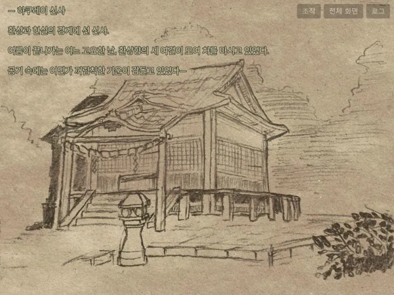 | 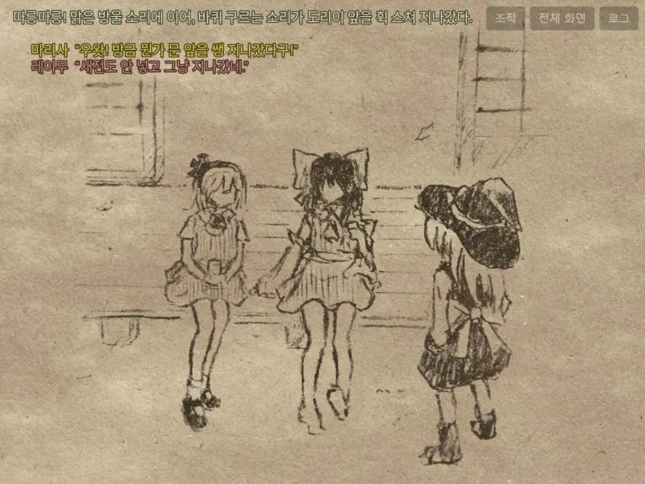 | 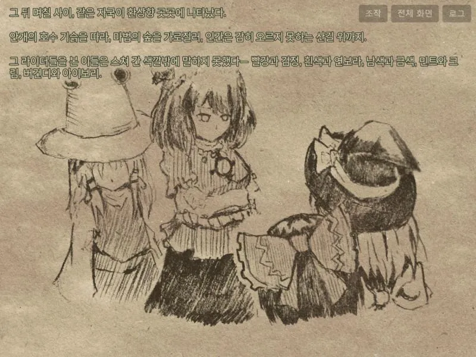 |
| 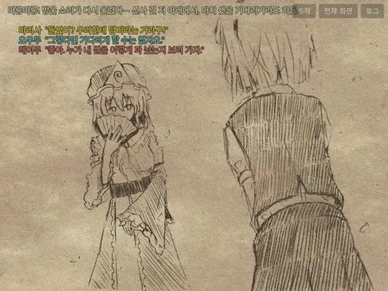 | 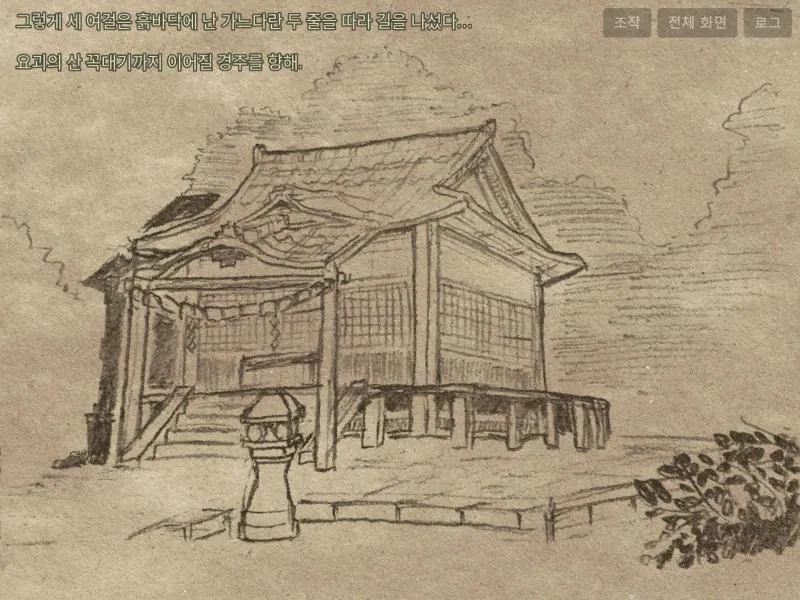 | |

| 프롤로그(영어) | |
| --- | --- |
| 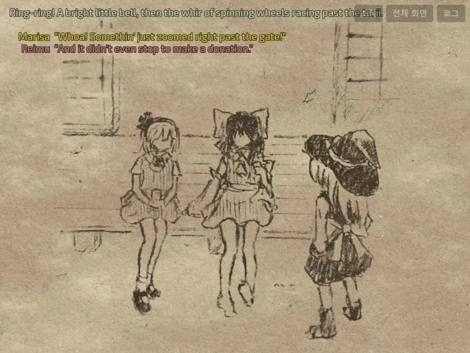 | 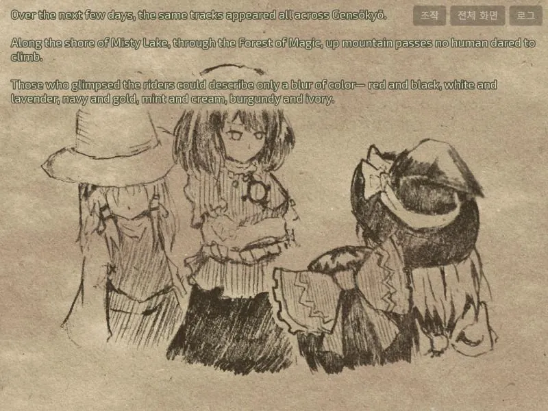 |

| 엔딩·엑스트라 추가 장면(한국어) | | |
| --- | --- | --- |
| 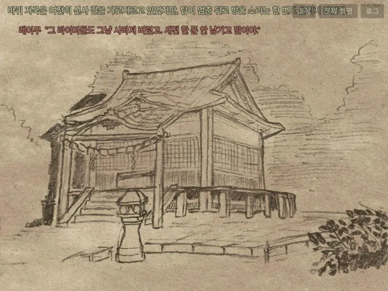 | 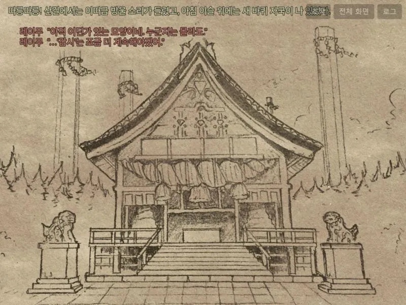 | 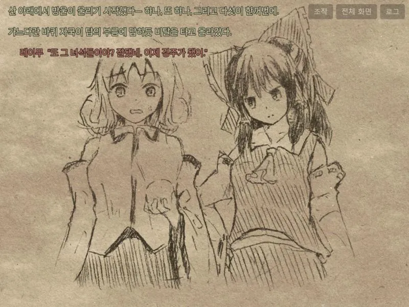 |
| 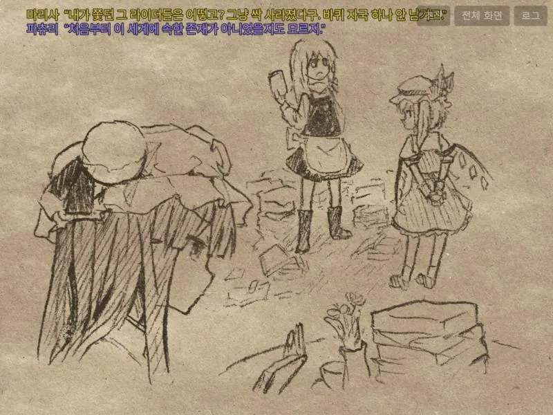 | 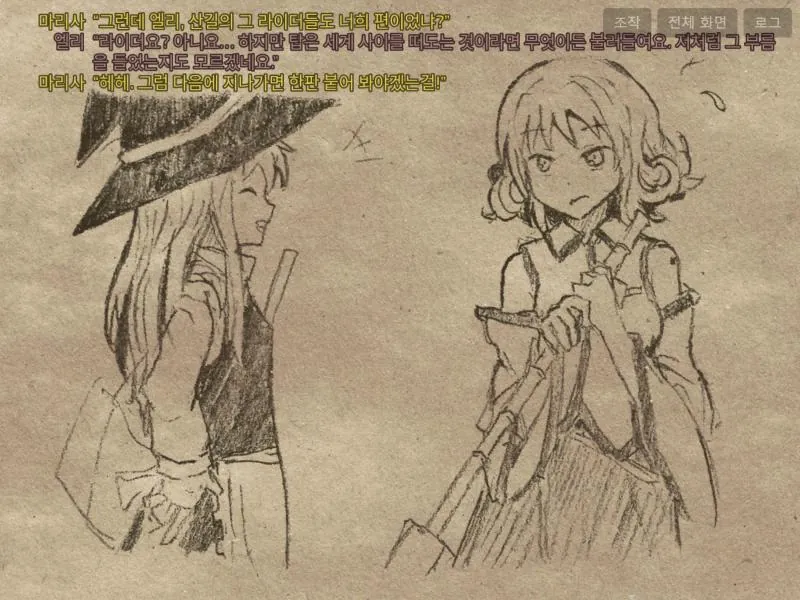 | 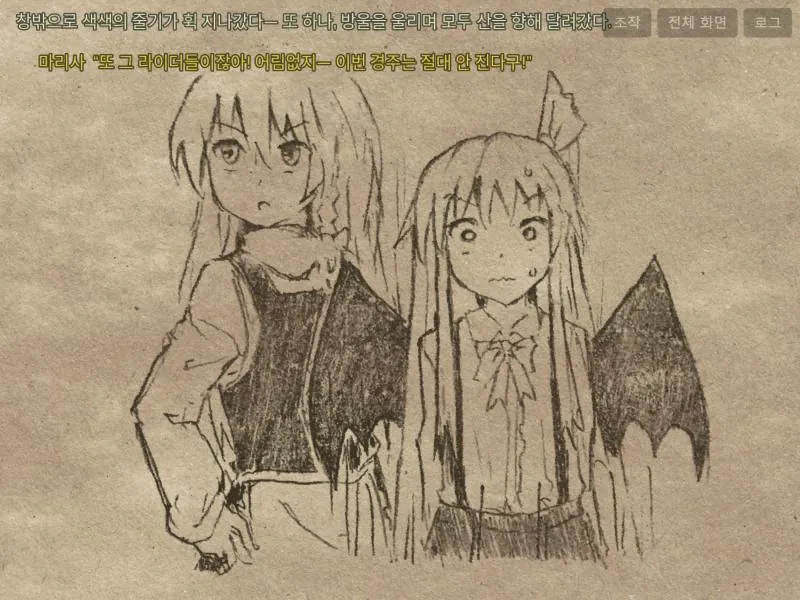 |
| 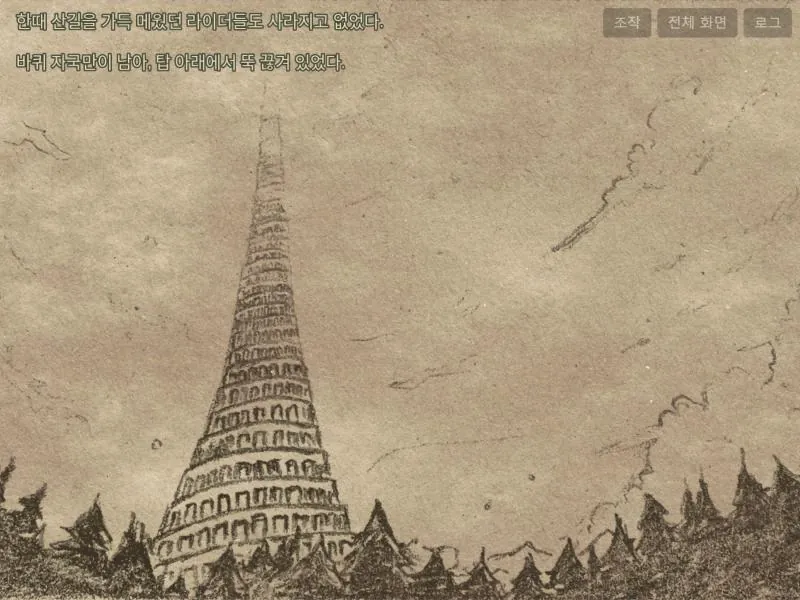 | 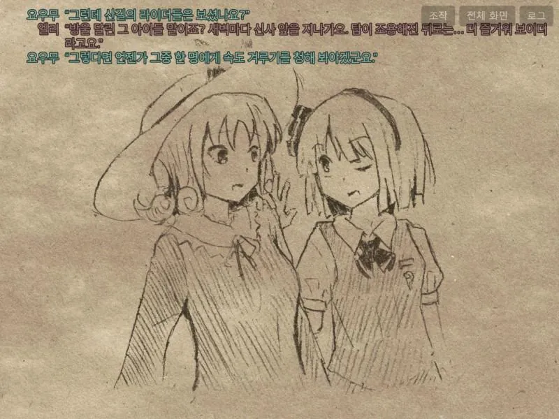 | 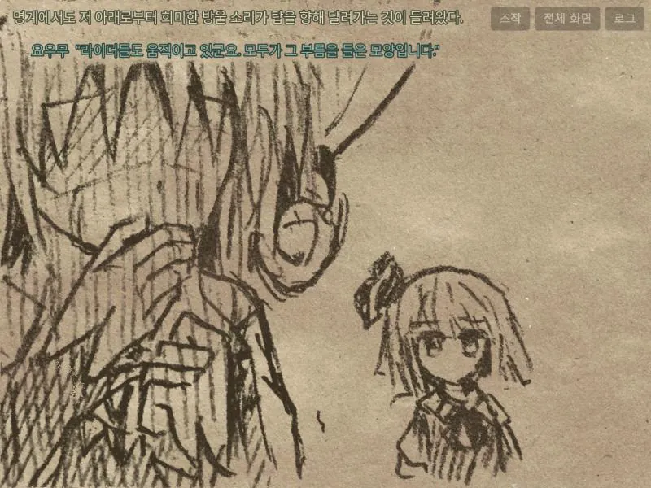 |
