# UI 현대화 1단계 — 메인 메뉴·난이도·캐릭터 선택

게임의 스타일(泰西 로고, 붓글씨 난이도, 중력 렌즈 배경, 기존 일러스트)은 그대로 두고, 오래된 느낌을 주던 요소(판타지풍 제목 글꼴, 빽빽한 작은 목록, 장식 없는 검은 띠, 배경과 분리되지 않는 초상화)를 요즘 UI처럼 정리했다. 그림 파일과 게임 규칙·입력·리플레이는 건드리지 않았다.

- fork 브랜치: `kthss01/taisei` `feat/ui-modern-menus` (fork `master` `84b414f7` 기준 — 인트로 건너뛰기·한국어 l10n·자동 발사 머지 이후)
- 메인 브랜치: `feat/ui-modern-menus` (origin/main `141effc` 기준, gitlink 갱신 + 이 문서)
- 초상화 교체 절차: [PORTRAITS.md](PORTRAITS.md)

## 1. 디자인 언어

| 요소 | 내용 |
| --- | --- |
| 글꼴 | 메뉴 전용 `title`(Exo 2 Regular 36px)·`heading`(22px) 추가. 본문은 기존 `standard`(17px)·`small`(12px). 게임 안 텍스트가 쓰는 `big`(immortal)은 1단계에서 유지 |
| 글자 셰이더 | `text_ui`: 글리프의 바깥 테두리 채널을 어두운 번짐으로 깔아 밝은 배경에서도 읽히게 함 |
| 색 | 어두운 남색 바탕 위 흰 글자, 선택 강조는 금색 `(0.96, 0.78, 0.42)`. 캐릭터별 포인트 색(Reimu 붉은색, Marisa 금색, Yōmu 청록), 난이도는 기존 `difficulty_color()` |
| 패널 | `ui_panel` 셰이더(SDF 둥근 사각형, 채움 그라데이션, 테두리). 반경을 크게 주면 원이 되어 점 인디케이터에도 사용 |
| 초상화 연출 | `sprite_portrait` 셰이더: 바닥 16% 페이드, 알파 경계를 따라가는 캐릭터 색 림라이트, 가벼운 채도·대비 보정. 뒤에는 캐릭터 색 방사형 글로우(`gfx/ui/glow.png`) |
| 모션 | 기존 `drawdata` 보간 유지. 이름 X축 회전 제거, 왼쪽에서 밀려 들어오는 슬라이드·페이드. 초상화는 2px 호흡, 글로우는 천천히 밝기 변화 |

## 2. 화면별 변경

### 메인 메뉴 (`src/menu/mainmenu.c`)
- 왼쪽 가독성용 가로 그라데이션, 항목 간격 20 → 36px, `heading` 글꼴
- 선택 항목 앞 금색 강조 바, 비활성 항목은 흰색 22%
- 로고는 오른쪽(`SCREEN_W - 240, 250`)으로 옮기고 회전 등장은 각도를 120° → 60°로 줄여 유지. 꽃잎 파티클 유지
- 좌하단 조작 힌트, 우하단 면책 문구 알파 0.5 → 0.35

### 난이도 선택 (`src/menu/difficultyselect.c`)
- 회전하는 검은 띠 → 중앙 유리 패널(620×190, 난이도 색 1px 테두리)
- 왼쪽: 붓글씨 난이도 그림의 세로 캐러셀(선택 0.58배, 나머지 0.32배)
- 오른쪽: 난이도 이름(`title`, 난이도 색) + 설명문(`standard`)
- 아래: 난이도 수만큼 점 인디케이터. Lunatic 떨림은 진폭 절반으로 유지

### 캐릭터 선택 (`src/menu/charselect.c`)
- 왼쪽 열: 풀네임(`title`) + 캐릭터 색 칭호, 샷 모드 두 장의 카드(활성 카드만 캐릭터 색 테두리와 설명 펼침), 캐릭터 칩 3개(선택 칩은 캐릭터 색으로 채움)와 `‹ ›`, 조작 힌트
- 오른쪽: 캐릭터 색 글로우 → `sprite_portrait`로 초상화·표정 합성. 선택되지 않은 캐릭터는 오른쪽으로 미끄러지며 어두워짐
- 얼굴 선택 로직(`facedefs`), 입력 처리, 콜체인, `set_player_mode`는 그대로

### 공통 (`src/menu/common.c`, `common.h`)
- `draw_menu_title()`: `heading` 글꼴 + 금색 강조선. 옵션·리플레이·뮤직룸 등 모든 메뉴 제목에 적용
- `draw_ui_panel()`, `draw_ui_dot()` 추가(`UIPanelParams`)

## 3. 추가한 자원 (fork)

| 경로 | 내용 |
| --- | --- |
| `resources/00-taisei.pkgdir/shader/ui_panel.{prog,frag.glsl}` | 둥근 사각형 패널 |
| `resources/00-taisei.pkgdir/shader/sprite_portrait.{prog,vert.glsl,frag.glsl}` | 초상화 연출 |
| `resources/00-taisei.pkgdir/shader/text_ui.{prog,frag.glsl}` | 메뉴 글자 |
| `resources/00-taisei.pkgdir/fonts/title.font`, `heading.font` | 메뉴 글꼴 정의(기존 Exo 2 TTF 재사용) |
| `resources/00-taisei.pkgdir/gfx/ui/glow.png`, `glow.spr` | 256×256 방사형 글로우(Pillow로 생성) |

셰이더는 기존 규약(`#version 330`, `UNIFORM(n)`, `#include`)을 따르며 웹 빌드에서 기존 셰이더와 같은 경로로 ESSL로 변환된다. **새 `.glsl` 파일은 `resources/00-taisei.pkgdir/shader/meson.build`의 `glsl_files` 목록에 있어야 변환된다.** 목록은 `PYTHONPATH=scripts python scripts/upkeep/update-glsl-sources.py`로 다시 만든다(이번 작업에서 이를 빠뜨려 첫 실행이 `res/shader/lib/sprite_default.vert.glslh does not exist` 치명적 오류로 중단됐다). 느슨한 텍스처(`gfx/ui/`)와 `.prog`·`.font`·`.spr`는 정적 리소스 인덱스가 자동으로 포함한다.

## 4. 전/후 비교

`screenshots/` 안의 webp. "전"은 공개 주소(main `0c6ffd5`, Taisei `f59212b7`)를 내장 브라우저 800×600으로 찍은 것이다.

| 화면 | 전 | 후 |
| --- | --- | --- |
| 메인 메뉴 | 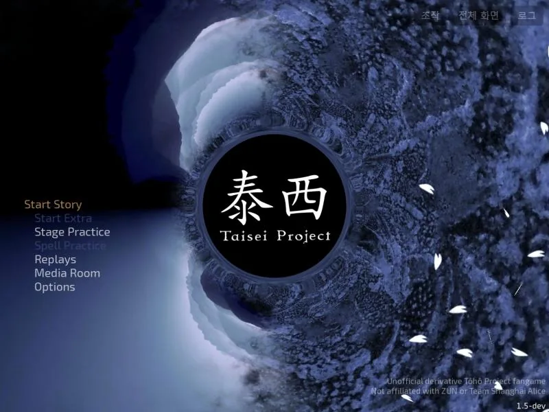 |  |
| 난이도 선택 | 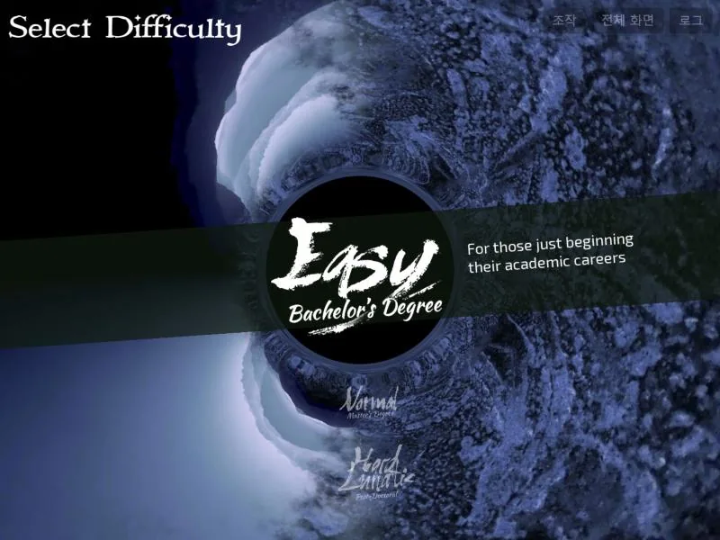 | 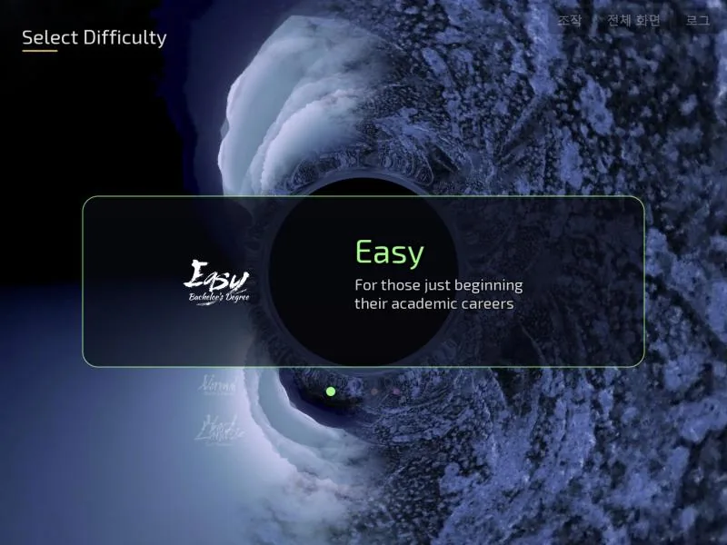 |
| 캐릭터 선택 (Reimu) | 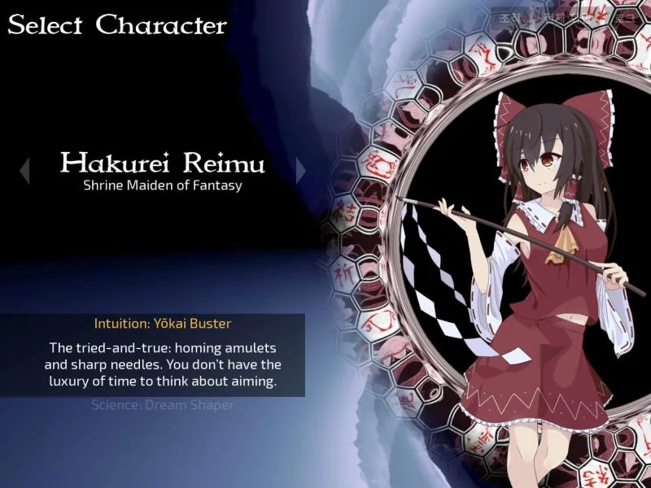 | 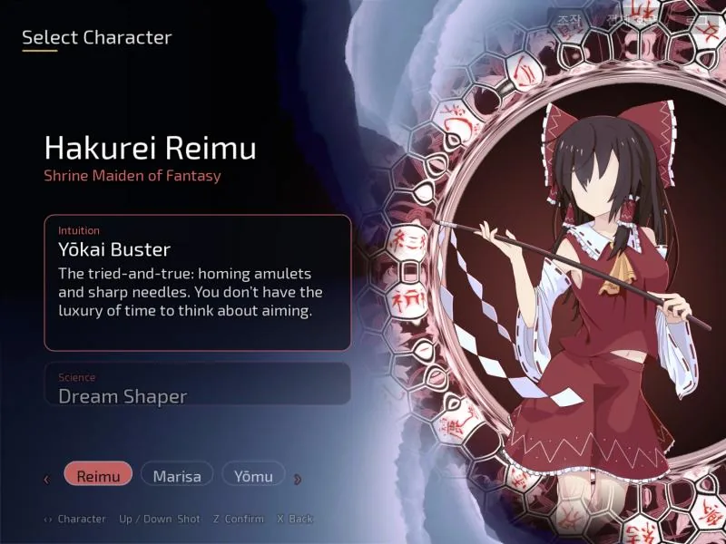 |
| 캐릭터 선택 (Marisa) | 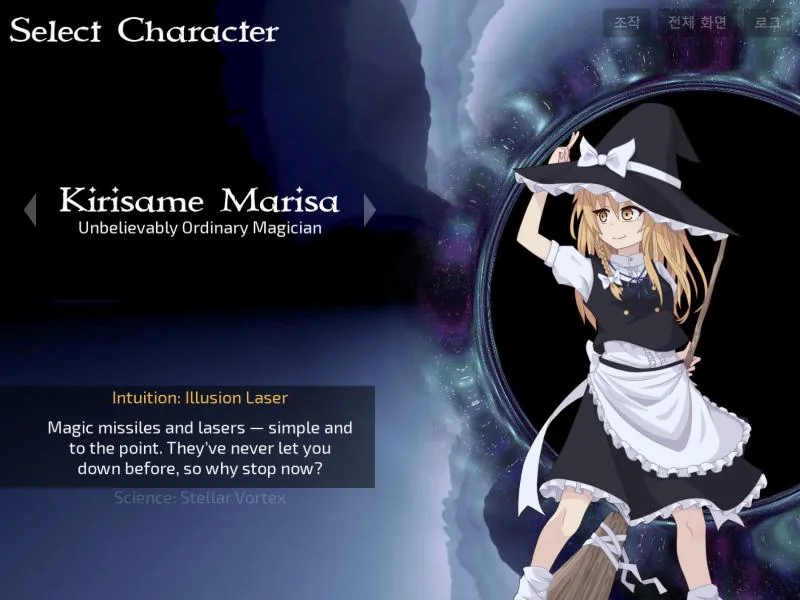 | 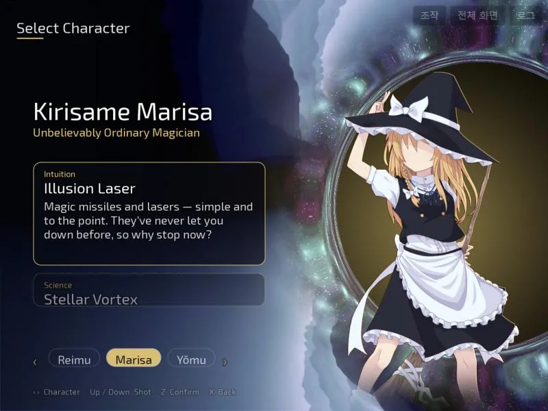 |
| 캐릭터 선택 (Yōmu) | 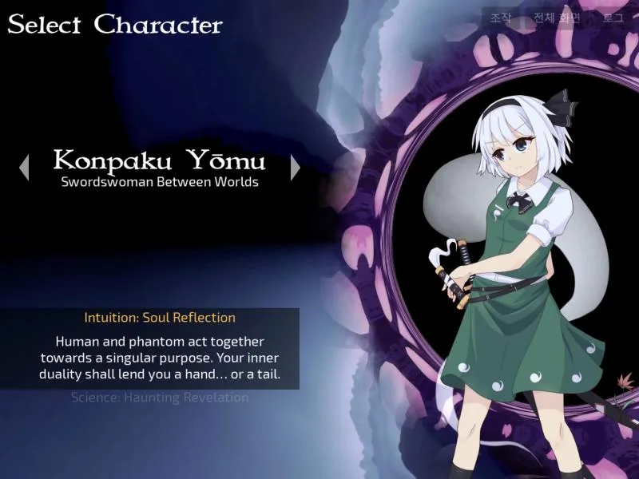 | 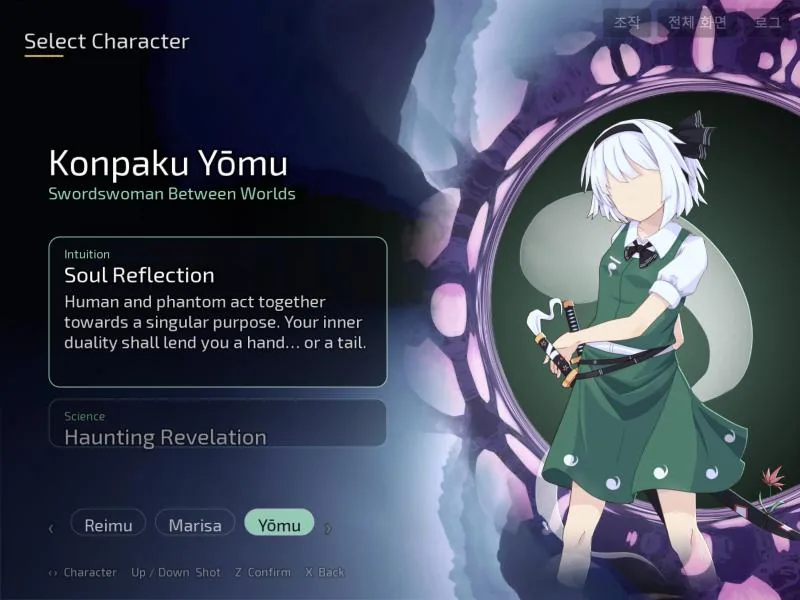 |
| 캐릭터 선택 (Yōmu, 샷 B) | 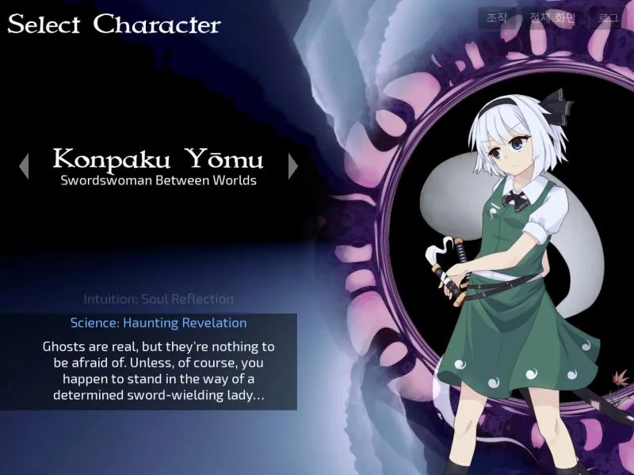 | 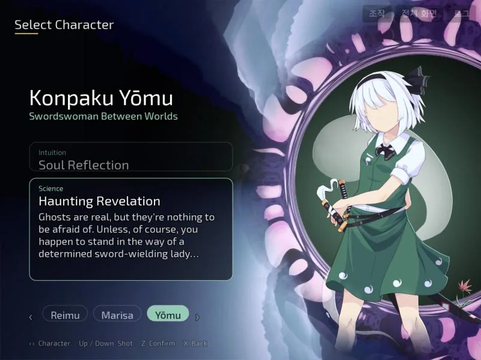 |

스테이지 1 진입 직후(HUD·플레이는 손대지 않음): 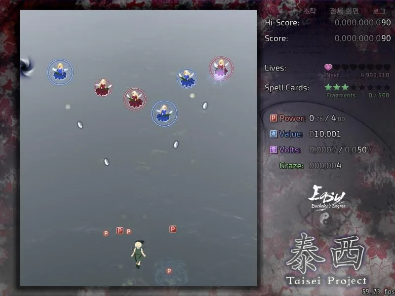

## 5. 검증

검증일 2026-10-29 · 환경: Windows 11 + Docker Desktop(`scripts/build-web.ps1 -Force`, emsdk 5.0.3) · 확인 도구: Claude 데스크톱 앱 내장 브라우저(Chromium), 뷰포트 800×600.

### 빌드 중 겪은 오류와 해결

| 순서 | 증상 | 원인 | 해결 커밋 |
| --- | --- | --- | --- |
| 1 | 컴파일 실패 `redefinition of 'font'` (`-Werror`) | `draw_main_menu()`에 새로 둔 `Font *font`가 아래 면책 문구용 변수와 충돌 | fork `85b7c400` (변수 이름 `menu_font`) |
| 2 | 실행 직후 abort, 로그 `glsl_process_file: VFS error: Node 'res/shader/lib/sprite_default.vert.glslh' does not exist` | 새 `.glsl`이 `shader/meson.build`의 `glsl_files`에 없어 ESSL로 변환되지 않고 원본 GLSL이 실려, 웹에는 없는 include 파일을 실행 시 찾음 | fork `69d35a88` (`update-glsl-sources.py`로 목록 갱신) |
| 3 | 메인 메뉴 중앙에 렌즈 배경의 검은 구멍이 드러남 | 로고를 오른쪽으로 옮겼는데 구멍은 중앙에 남음 | fork `f2d666e3` (구멍 중심을 로고 아래로) |

### 결과

| 항목 | 값 |
| --- | --- |
| fork 최종 커밋 | `237ee344` (origin/master `84b414f7` 위에 rebase. 본문 `f593e2bc` → font 수정 `11a79be0` → 셰이더 목록 `6fded88e` → 렌즈 구멍 `3abde76f` → 한국어·CJK 글꼴 `237ee344`) |
| 메인 저장소 기준 | origin/main `141effc` |
| 빌드 | `build-web.ps1 -Force` 6분 7초, Emscripten 5.0.3 |
| 정적 검사 | `check-web-assets.py --require-wasm --verify-hashes` 통과 (리소스 543개, 207.3 MiB, `taisei.wasm` 4,544,946바이트) |
| 확인한 화면 | 메인 메뉴, 난이도(Easy·Normal 전환), 캐릭터 선택 3명 × 샷 A/B, 옵션·미디어 룸·리플레이 제목 스타일, 스테이지 1 진입 — 영어·한국어 각각 |
| 콘솔 | 셰이더·리소스 오류 없음. 기존에 알려진 `res/shader/global.pp`, `res/config.default` 없음 메시지만 남음 |
| 한국어 UI | 시스템 언어가 한국어라 첫 실행이 한국어로 뜬다. 메뉴 항목·이름·칭호·카드·칩·힌트 모두 `title_cjk`/`heading_cjk`(Source Han Sans 36/22px)로 같은 크기로 표시되고, 새 힌트 2건은 `po/ko.po` 번역이 적용된다 |
| 미확인 | 실제 Chrome·소리·전체 화면·게임패드(기존 #27·#28 범위). 재생성한 초상화 아틀라스의 실제 로드([PORTRAITS.md](PORTRAITS.md) 3절) |

#### 한국어 UI

| 화면 | 후(한국어) |
| --- | --- |
| 메인 메뉴 | 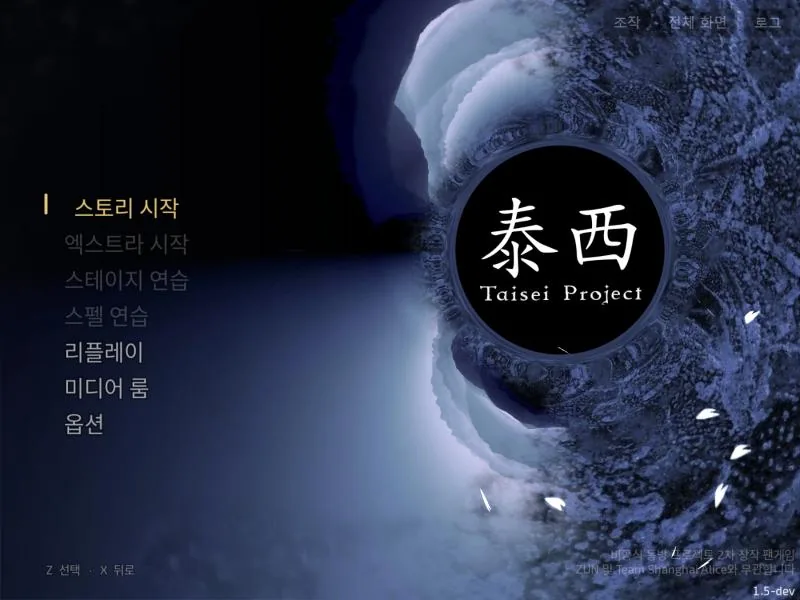 |
| 난이도 선택 | 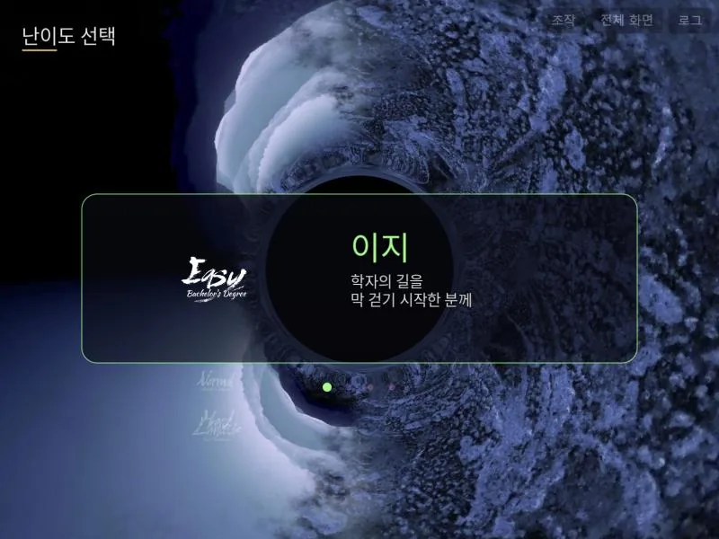 |
| 캐릭터 선택 (Reimu) | 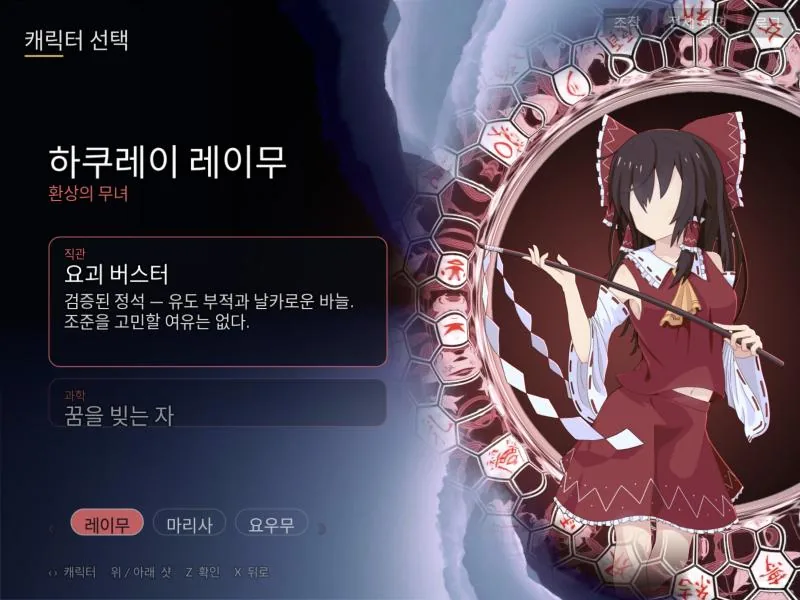 |
| 캐릭터 선택 (Marisa) |  |
| 캐릭터 선택 (Yōmu) | 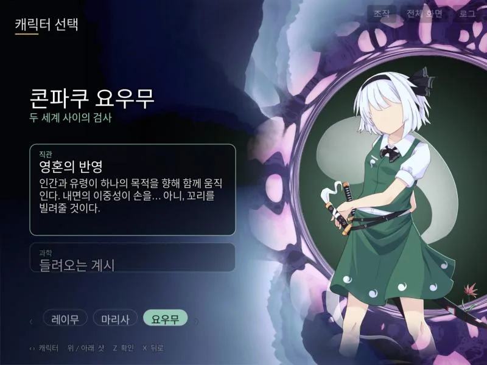 |
| 캐릭터 선택 (Yōmu, 샷 B) | 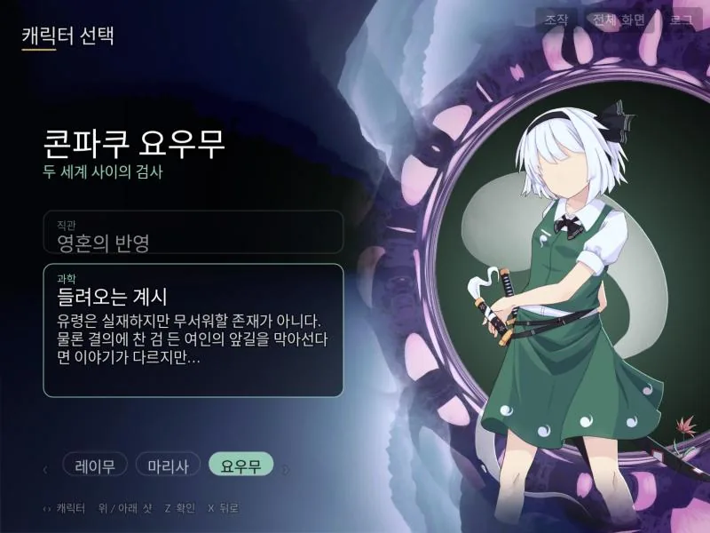 |

## 6. 다음 단계 후보

- 웹 시작 페이지(`web/game/shell.css`) 재디자인
- HUD·일시정지 메뉴·옵션 화면
- 화면 전체 후처리(컬러 그레이딩·글로우)와 탄막 표현(#31)
- 새 초상화가 준비되면 [PORTRAITS.md](PORTRAITS.md) 절차로 교체
